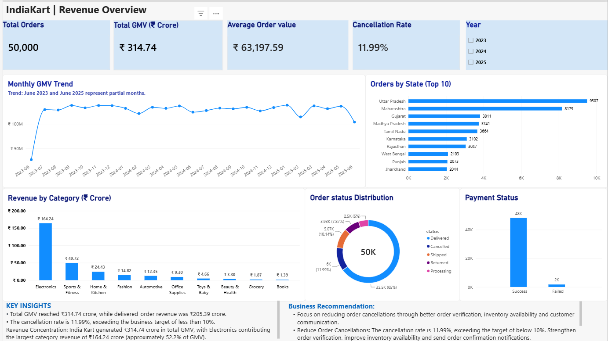

# IndiaKart E-Commerce Analytics

**End-to-End Data Analytics Project | Python | SQL | Excel | Power BI**

## 1. Project Overview

IndiaKart E-Commerce Analytics is an end-to-end data analytics project based on e-commerce business data covering sales, orders, customers, payments, returns, products, suppliers and inventory.

The main objective was to analyse business performance, identify operational problems, understand customer behaviour and provide useful insights to support better business decisions.

**Analysis Period:** 24 June 2023 – 23 June 2025

## 2. Business Objectives

- Analyse sales and revenue performance.
- Identify top-performing products and categories.
- Understand customer behaviour and customer segments.
- Monitor order cancellations and payment failures.
- Analyse product returns and inventory levels.
- Calculate important business KPIs.
- Build an interactive Power BI dashboard.
- Provide actionable business recommendations.

## 3. Tools and Technologies

| Tool | Purpose |
|---|---|
| Python | Data cleaning, EDA and visualization |
| Pandas, NumPy | Data manipulation and analysis |
| Matplotlib, Seaborn | Data visualization |
| SQL | Business queries and KPI calculations |
| Excel | Data review and analysis |
| Power BI | Interactive dashboards and reporting |

## 4. Project Workflow

### Phase 1 – Python: Data Cleaning

- Inspected eight datasets.
- Checked missing values and duplicate records.
- Validated data types and date columns.
- Performed data quality checks.
- Documented data cleaning observations.

### Phase 2 – Python: Exploratory Data Analysis

- Analysed sales and order trends.
- Explored product and category performance.
- Studied customer behaviour and segmentation.
- Analysed payment methods and return reasons.
- Examined customer age and inventory patterns.
- Created charts to understand business trends.

### Phase 3 – SQL: Business KPIs

- Created SQL queries to analyse business performance.
- Calculated GMV and delivered revenue.
- Analysed average order value.
- Calculated cancellation and return rates.
- Analysed payment failure rate.
- Studied customer value and inventory fill rate.
- Performed customer cohort analysis.

### Phase 4 – Power BI: Dashboard and Management Report

Created a five-page interactive dashboard:

1. Revenue Overview
2. Category Performance
3. Customer Insights
4. Operations Overview
5. Inventory Alert

Also prepared a CEO Management Report containing key findings, business risks, growth opportunities and recommendations.

## 5. Key Business Findings

| Business Metric | Result |
|---|---:|
| Total GMV | ₹314.74 Crore |
| Delivered Revenue | ₹205.39 Crore |
| Total Orders | 50,000 |
| Total Customers | 10,000 |
| Active Customers | 8,775 |
| Cancellation Rate | 11.99% |
| Payment Failure Rate | 3.50% |
| Reported Return Rate | 30.77% |

### Additional Insights

- Electronics contributes 57.41% of category revenue.
- Electronics and Sports & Fitness together contribute 74.79% of category revenue.
- Premium customers average 8.61 orders, compared with 0.56 for Inactive customers.
- 78 inventory records are below their reorder levels.
- 2 inventory records are out of stock.

## 6. Business Recommendations

1. **Reduce cancellations:** Improve order verification and check stock availability before confirming orders.
2. **Improve payment success:** Investigate failed transactions and monitor payment gateway performance.
3. **Reduce product returns:** Analyse return reasons and address recurring product quality, description and delivery issues.
4. **Improve inventory management:** Prioritize the 78 low-stock records and investigate the 2 out-of-stock records.
5. **Improve customer retention:** Focus on retaining Premium customers and encouraging Inactive customers to return.

## 7. Project Deliverables

- Python data inspection script.
- Phase 1 data cleaning notebook.
- Phase 1 data quality report.
- Phase 2 EDA notebook.
- Phase 3 KPI analysis notebook.
- SQL analysis file.
- Power BI dashboard.
- CEO Management Report.

## 8. Dashboard Preview

<!-- Save the screenshot as images/indiakart_dashboard.png -->

## 9. Conclusion

This project helped me understand how data analytics can support real business decisions. I worked through data cleaning, exploratory analysis, SQL-based KPI calculations and Power BI dashboard development.

The analysis identified important opportunities to improve revenue performance, customer retention, payment success, order completion and inventory management.

---

**Project:** IndiaKart E-Commerce Analytics  
**Developed by:** Raghavendra Mamidala  
**Role:** Data Analyst Project  
**Tools:** Python | SQL | Excel | Power BI
